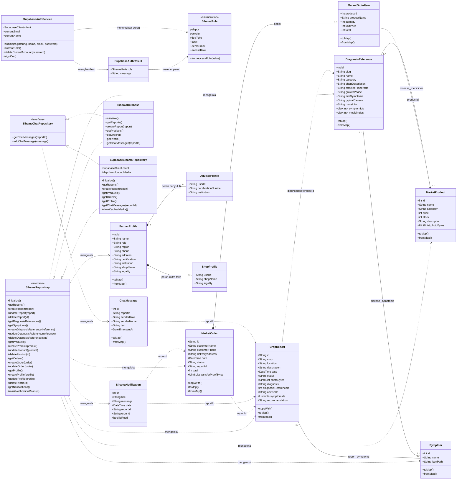

# SIHAMA Class Diagram

Diagram kelas ini menampilkan model domain, kontrak repository, implementasi penyimpanan, dan autentikasi SIHAMA.

## Catatan relasi

- `MarketOrder` berisi satu atau lebih `MarketOrderItem`. Item menyimpan ID, nama, dan harga produk saat transaksi.
- Pesanan baru harus merujuk ke laporan pelapor yang berstatus `Selesai Ditinjau`; `reportId` tetap opsional untuk membaca pesanan historis.
- `CropReport.symptomIds` dan gejala penyakit dipersistenkan sebagai relasi many-to-many, bukan hanya teks pada deskripsi.
- Obat yang direkomendasikan untuk penyakit disimpan melalui relasi `disease_medicines`; rekomendasi spesifik laporan tetap tersimpan pada `CropReport`.
- `FarmerProfile` memuat detail khusus Penyuluh atau Mitra Toko melalui profil peran masing-masing.
- `SihamaNotification` memiliki relasi opsional ke laporan atau pesanan dan status baca.
- `ChatMessage.reportId` menghubungkan pesan percakapan dengan laporan.
- Pemilik laporan disimpan sebagai `owner_id` di Supabase, bukan sebagai field pada class `CropReport`.
- `FarmerProfile` menyimpan data profil aplikasi; autentikasi akun ditangani terpisah oleh Supabase Auth.
